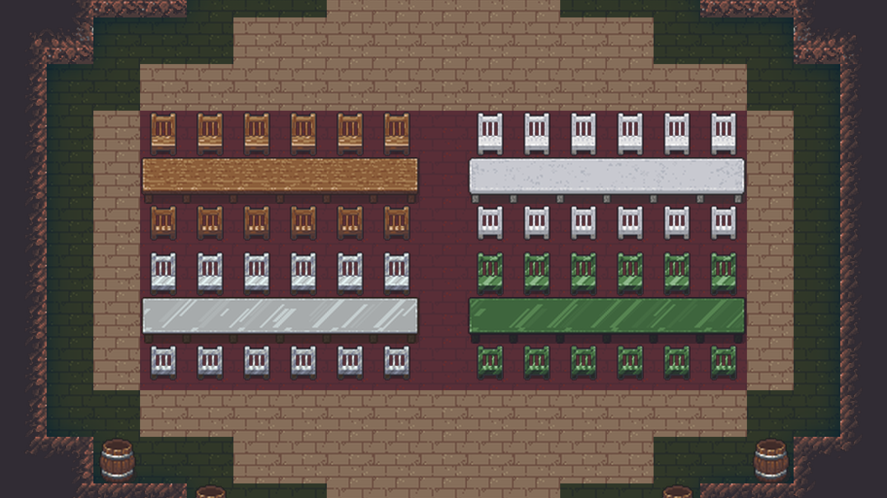
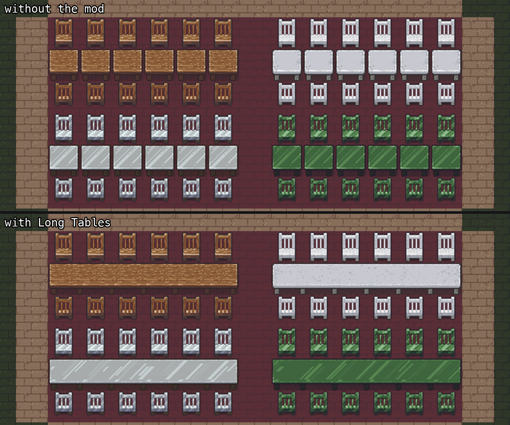
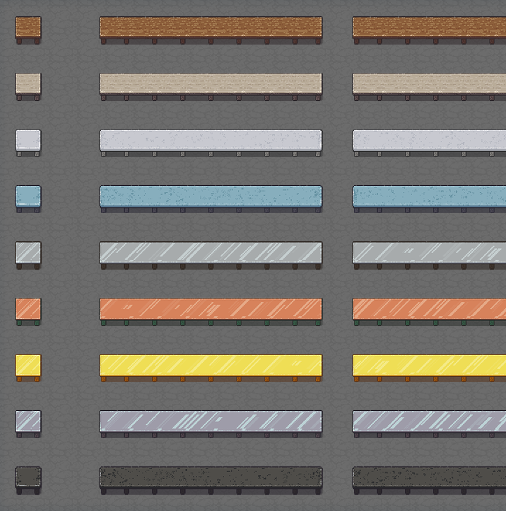
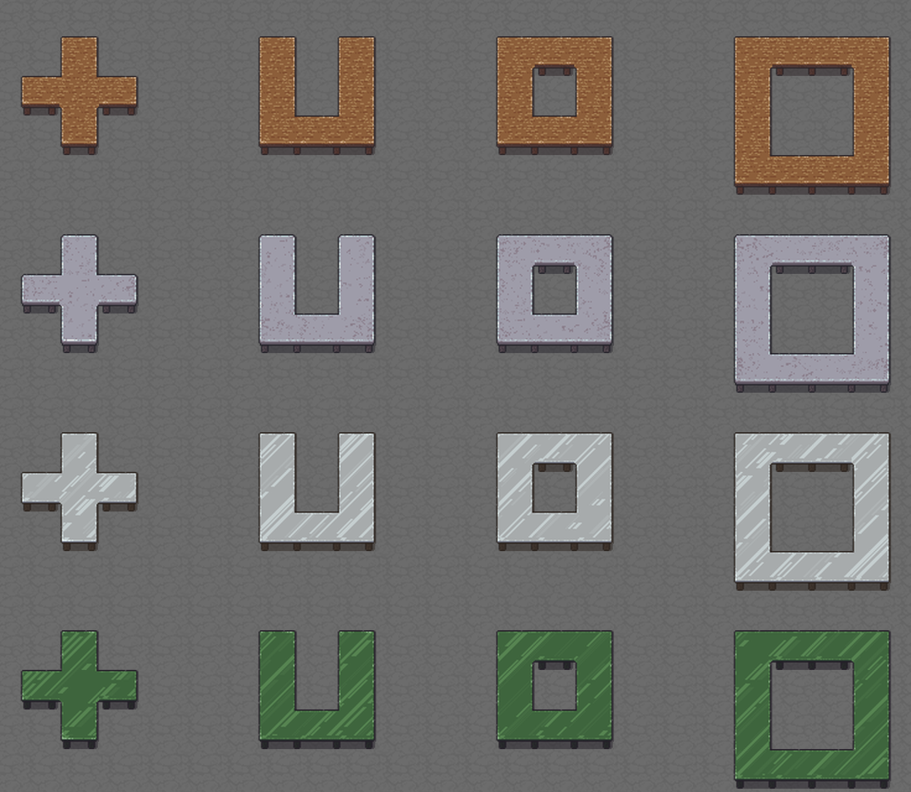

# Long Tables

A DFHack script for Dwarf Fortress that draws tables built next to each other, of the same
material, as one table: the top runs through from tile to tile and a single leg stands under
every join. Rows make long tables; rows next to rows make wide ones, and L, T, U, plus and ring
shapes join up too. It is purely cosmetic. The tables stay separate tables to the game, nothing is stored in
the save, and without the mod every table looks as it did before.









The chairs in the pictures are from [New and Improved Chairs](https://github.com/vaneyckt7/df-new-and-improved-chairs), a separate mod; Long Tables changes tables only.

## What joins

- Finished tables on the same level, next to each other west to east or north to south, made
  of exactly the same material (two granite tables join; a granite and a marble one do not).
  Quality and decorations make no difference.
- Tables that touch only at a corner do not join.
- A table that dwarves are taking apart stays joined until it is gone; one still being built
  joins when it is finished.
- A table with no like neighbour is left to the game, untouched.

The art is the game's own table. The ends of a joined table are the game's table ends; the
stretch in between continues the surface (wood grain, stone speckles, the sheen on metal and
glass) so that neighbouring tiles do not repeat, and it is coloured from the material with the
game's own palette for it.

## Requirements

DFHack, kept up to date (Steam does that for you). The mod is plain Lua run by DFHack; there is
no compiled plugin. Tested on Dwarf Fortress 53.17 (the Steam Windows build, run under Wine on
macOS) with the graphical tiles, and DFHack 53.17-r1. Native Windows, Linux and Proton are
untested.

## Installation

1. Subscribe and wait for Steam to finish downloading.
2. Fully exit the game, start it again through DFHack and load your fortress.

Existing saves work. Do not add the mod to a world's mod list at world generation: it adds
nothing to a world, and a world made with it keeps running the copy the game stored for that
world, even after an update. Besides `info.txt`, the preview picture, the licence and this
readme, the mod is two files, used where they are:

```
scripts_modinstalled/long-tables.lua                        the script
scripts_modinstalled/internal/long-tables/template.lua      the table art
```

It writes no files of its own (DFHack notes the widget in `dfhack-config/overlay.json`), does
not use the network and stores nothing in your save.

To switch it off without removing it: `overlay disable long-tables.map`. To uninstall,
unsubscribe. The game keeps its own copies of subscribed mods, which can outlive the
subscription: a folder named after the Workshop item's number under `mods` in the Dwarf
Fortress install folder, and, only if the mod was ever added to a world, `long_tables (100)`
under `data/installed_mods` in the game's data folder (on Windows
`%APPDATA%\Bay 12 Games\Dwarf Fortress`, or the install folder itself on a portable install).
Delete those if tables still join after unsubscribing.

Messages go to the DFHack console, on lines starting with `long-tables:`.
`long-tables status` prints what has been drawn.

## How it works

Every frame the game draws the map into layers of texture numbers, one cell per map tile; a
table's picture goes in the building layer. The `long-tables.map` overlay widget runs after
the game has filled the layers and before they reach the screen. It notes the material of each
finished table in view and gives every table that has a like neighbour the texture that fits
its place: a left end, a middle or a right end, with the legs making way for more table top
where the table goes on to the south. Tables up to eight levels below, seen through open space,
get the same treatment. Only cells the game put a building picture in are changed.
Creatures and items are other layers, drawn over the table as before.

Each tile is painted once per material colour, piece and position along the table (sixteen
stretches of surface, after which the pattern repeats) and then reused. The script remembers
where the tables are and what it drew, and looks again when a table is built or removed, when
the view moves, and about every twenty seconds regardless.

## The art

`art/extract_sprites.py <game folder>` reads the game's own table sprites and writes them as
palette shades to `art/table_sprites.txt`. `art/make_template.py` builds the joined pieces and
the long strips of surface from that and writes
`scripts_modinstalled/internal/long-tables/template.lua`, which is what the script reads
(DFHack's Lua cannot read a PNG). After changing the art, copy `template.lua` over the installed
one and run `long-tables reload`. `long-tables singles only` draws every table as a lone one
from the template, to compare it with the game's.

## Tests

```sh
lua test/run_tests.lua                 # any Lua 5.3 or later; DFHack and the game are stubbed
python3 art/make_template.py --check   # the template matches the art
```

## Known limitations

- Fortress mode with the graphical tiles only; no ASCII, no adventure mode.
- If a tool cancels a removal job half way, the table can look joined for up to about twenty seconds more.
- A mod that replaces the game's table sprite is not picked up: joined tables are drawn from
  the vanilla table, lone tables by the game.
- The script reads the game's map layers by the names DFHack gives them. A game update that
  changes how the map is drawn can stop tables from joining until the script is updated; the
  game's own tables show in the meantime.

## Licence

The code is MIT; see [LICENSE](LICENSE). The table art (`art/table_sprites.txt` and
`template.lua`) is derived from Dwarf Fortress's own table sprites, which belong to Bay 12
Games; the MIT licence does not cover it.
